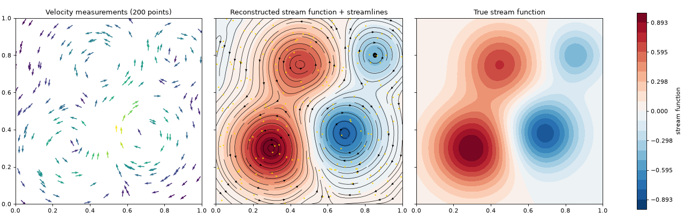
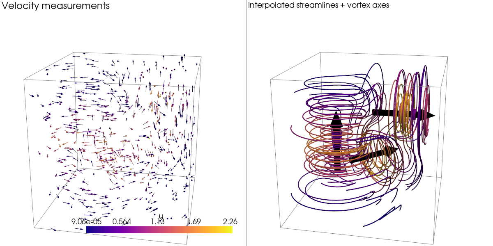
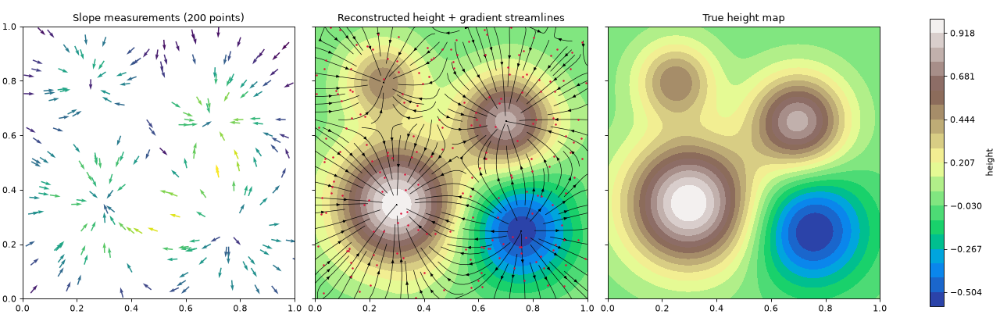
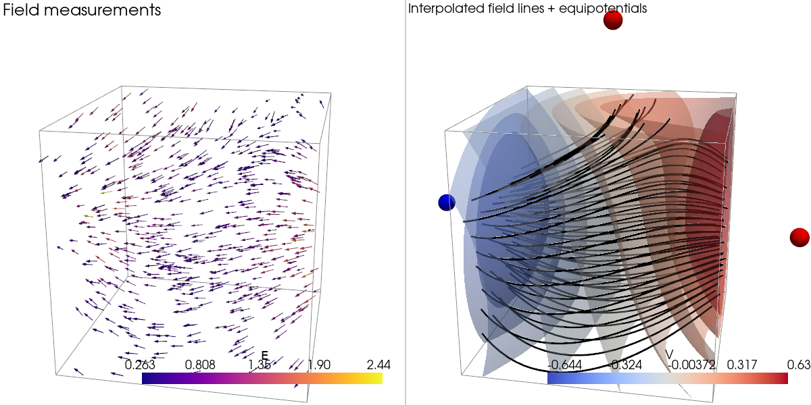
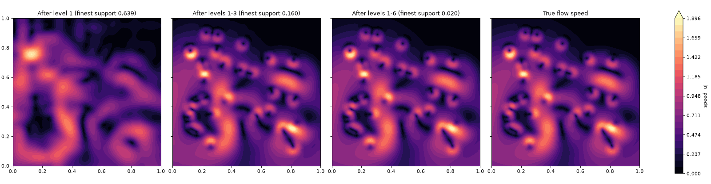

# Divergence Free Interpolation

Interpolation of scattered vector data with fields that are **exactly divergence-free** or
**exactly curl-free**, in 2D, 3D and higher dimensions. It uses the matrix-valued radial basis
functions of Fuselier [[1]](#1), built from Wendland's compactly supported functions [[2]](#2),
so the linear systems are sparse. Multilevel variants [[3]](#3) handle large and multi-scale
data sets accurately.

> **About the name:** the package started out divergence-free only. The curl-free interpolant
> comes from the same paper and shares all of the machinery, so it lives here too, despite the
> name.

| Divergence-free (`DivergenceFreeInterpolant`) | Curl-free (`CurlFreeInterpolant`) |
|---|---|
| Incompressible flow, magnetic fields: anything with zero divergence | Gradients, electrostatic fields, slopes: anything with zero curl |
| 2D: `stream_function()`, whose contour lines are the streamlines | `potential()`: the scalar potential whose gradient is the field |

### Divergence-free

A 2D flow reconstructed from 200 scattered velocity measurements, including its stream
function, and a 3D flow of swirling vortices:





### Curl-free

A landscape reconstructed from 200 scattered slope measurements (the height map is the recovered
potential), and an electric field with its equipotential surfaces recovered from field
measurements:





### Multilevel

A multi-scale flow reconstructed from 20 000 scattered velocity measurements, refined level by
level from coarse to fine (flow speed shown):



## Installation

```bash
uv add Divergence-Free-Interpolant
# or
pip install Divergence-Free-Interpolant
```

## Quick start

```python
import numpy as np
import divergence_free_interpolant as dfi

rng = np.random.default_rng(0)

# Sample positions and vectors, both of shape (N, dim): here a rotation, which is divergence-free
points = rng.random((200, 2))
values = np.column_stack([-points[:, 1], points[:, 0]])

interp = dfi.DivergenceFreeInterpolant(support_radius=0.3).fit(points, values)

# Evaluate at points of shape (..., dim) to get vectors of shape (..., dim)
interp(np.array([0.5, 0.5]))  # shape (2,)
interp(rng.random((1000, 2)))  # shape (1000, 2)
grid = np.stack(np.mgrid[0:1:50j, 0:1:50j], axis=-1)
interp(grid)  # shape (50, 50, 2)

# 2D only: the stream function, whose contour lines are the streamlines
interp.stream_function(grid)  # shape (50, 50)
```

The curl-free interpolant works the same way:

```python
# The gradient of |x|^2, which is curl-free
gradients = 2 * points

interp = dfi.CurlFreeInterpolant(support_radius=0.3).fit(points, gradients)
interp(points)  # the interpolated gradient field
interp.potential(points)  # its potential, up to a constant
```

For large or multi-scale data sets, the multilevel interpolants choose their support radii
from the data:

```python
interp = dfi.MultilevelDivergenceFreeInterpolant().fit(points, values)
interp(grid)

# Number of points and support radius per level, coarse to fine
[(level.n_points, level.support_radius) for level in interp.levels]
```

## API

### `DivergenceFreeInterpolant(support_radius, *, k=3, nu=None, solver='auto', tol=1e-10)`
### `CurlFreeInterpolant(support_radius, *, k=3, nu=None, solver='auto', tol=1e-10)`

- **`support_radius`** (required): radius of the compactly supported kernel. Each sample only
  influences the field within this distance. Larger values give smoother and usually more
  accurate fields, but denser, worse-conditioned systems. Start at a few times the typical
  spacing between samples. Far from all samples, the field and its potentials are exactly zero.
- **`k`**: smoothness of the Wendland function ψ<sub>ν,k</sub>, which is C<sup>2k</sup>. Must be
  ≥ 1. The default of 3 rarely needs changing.
- **`nu`**: Wendland parameter. It defaults to the smallest value that keeps the kernel positive
  definite, `dim // 2 + k + 1`. Smaller values raise a `ValueError` when you fit.
- **`solver`**:
  - `'direct'`: sparse factorisation.
  - `'cg'`: conjugate gradients, with relative tolerance `tol` (between 0 and 1).
  - `'lstsq'`: dense least squares. For small problems only; it tolerates duplicate points.
  - `'auto'`: uses `'direct'` in 2D (up to 250k unknowns) and for 3D systems up to 15k
    unknowns (5000 points), `'cg'` otherwise. If CG fails, for example on nearly coincident
    points, systems up to 50k unknowns are retried with `'direct'`.

### Methods

- **`fit(points, values)`**: `points` and `values` are arrays of shape `(N, dim)` with
  `dim >= 2`. The dimension is inferred from the data. Returns the interpolant, so calls can be
  chained. Duplicate points raise a `ValueError`, since they make the system singular. A failed
  fit leaves the previous fit untouched.
- **`interp(points)`**: evaluates at `points` of shape `(..., dim)` and returns vectors of shape
  `(..., dim)`.
- **`DivergenceFreeInterpolant.stream_function(points)`** (2D only): the stream function ψ, with
  the field equal to `(∂ψ/∂y, -∂ψ/∂x)`. Returns shape `(...)`.
- **`CurlFreeInterpolant.potential(points)`**: the potential P, with the field equal to `∇P`.
  Returns shape `(...)`.

Both scalar potentials are determined up to an additive constant. The ones returned here vanish
farther than `support_radius` from all samples.

### Multilevel interpolation

### `MultilevelDivergenceFreeInterpolant(*, support_factor=6.0, refinement=0.5, k=3, nu=None, solver='auto', tol=1e-10)`
### `MultilevelCurlFreeInterpolant(...)` (same parameters)

A single support radius has to compromise. Small supports are cheap, but they cannot bridge the
gaps between samples, so accuracy stays poor, and larger data sets with proportionally smaller
supports don't help. Large supports are accurate, but the systems become dense and
ill-conditioned. The multilevel interpolants of Farrell, Gillow & Wendland [[3]](#3) avoid this:

- The data is split into nested levels, from a few dozen well-spread points up to all of them,
  by greedy farthest-point sampling. Each level is quasi-uniform: its points are at least its
  spacing apart and cover all the data within that spacing.
- Each level interpolates what the coarser levels left over, with a support radius of
  `support_factor` × its spacing, and the spacing halves (`refinement`) from level to level. The
  finest level uses all the points, so the data is still interpolated exactly, and the result is
  still exactly divergence-free or curl-free.
- Every level's system stays sparse, and the quasi-uniform levels are well-conditioned
  (conjugate gradients converges in a few hundred iterations at any size).

They have the same `fit`, call, `stream_function`/`potential` methods as the single-level
interpolants. Two additions:

- `levels`: a per-level summary (number of points, spacing, support radius, solver and CG
  iterations).
- `levels=j`, an optional argument when evaluating, which sums only the j coarsest levels, to
  inspect the refinement.

`support_factor` controls the accuracy. Around 6 the levels reliably reduce the error. Below 5
the refinement can stall. Larger values are more accurate (8 is a good choice in 2D), but the
number of neighbours per point grows like `support_factor`<sup>dim</sup>.

### Performance

The kernels have compact support, so fitting builds a sparse system via KD-tree neighbour search,
and evaluation only visits nearby samples. Conjugate gradients uses a block-Jacobi preconditioner
over clusters of unusually close points, which random data always has.

Timings on one desktop machine, random points in the unit square/cube, `'auto'` solver. A
single level with about 30 (2D) or 50 (3D) neighbours per point (`benchmarks/bench_scaling.py`):

| single level | 1 000 points | 10 000 points | 100 000 points | evaluation |
|---|---|---|---|---|
| 2D fit | 0.05 s | 0.25 s | 7.6 s | 4–5 µs / point |
| 3D fit | 0.07 s | 0.34 s | 3.6 s | 7–12 µs / point |

Such small supports are fast but inaccurate. The multilevel interpolant (default settings) is
far more accurate for a few times the cost. Here is the RMS error against a smooth analytic
field (`benchmarks/bench_multilevel.py`):

| | 10 000 points | 100 000 points |
|---|---|---|
| 2D single level | 0.25 s, error 1.1 | 7.5 s, error 1.1 |
| 2D multilevel | 0.8 s, error 7.5 · 10⁻⁴ | 13 s, error 6.1 · 10⁻⁵ |
| 3D single level | 0.34 s, error 0.70 | 3.6 s, error 0.70 |
| 3D multilevel | 3.5 s, error 1.9 · 10⁻³ | 56 s, error 1.8 · 10⁻⁴ |

## Examples

Install the example dependencies with `uv sync --group examples`, then run e.g.
`uv run python examples/curl_free_2D.py`.

- [`examples/divergence_free_2D.py`](examples/divergence_free_2D.py): reconstructs a 2D
  incompressible flow of vortices from scattered velocity measurements, including its stream
  function, compared with the true one.
- [`examples/divergence_free_3D.py`](examples/divergence_free_3D.py): a 3D incompressible flow
  of swirling vortex blobs, shown as streamlines in pyvista.
- [`examples/curl_free_2D.py`](examples/curl_free_2D.py): reconstructs a landscape from
  scattered slope measurements, compared with the true height map.
- [`examples/curl_free_3D.py`](examples/curl_free_3D.py): electrostatics. Interpolates an
  electric field from scattered measurements and recovers the electric potential, shown as
  field lines and equipotential surfaces.
- [`examples/multilevel_2D.py`](examples/multilevel_2D.py): a multi-scale flow from 20 000
  scattered measurements. Shows the reconstruction after the first, the first three and all
  levels, compared with a single level.

## Migrating from 0.1

- The import name is now lowercase: `import divergence_free_interpolant as dfi`.
- `dfi.interpolant(nu, k, dim)` with `.condition(XY, UV, support_radii, method)` and
  `interp(x, y, z)` (positional or keyword coordinates) still works, but emits a
  `DeprecationWarning`. Its attributes (`XY`, `sol`, `N`, `support_radii`, `method`, `kernel`,
  `zero_kernel`) are still available, read-only. Two things deliberately behave differently,
  because the 0.1 behaviour was incorrect:
  - Duplicate points raise a `ValueError`, instead of producing a singular system and a
    meaningless result. `method='lstsq'` (or `'SVD'`/`'penrose'`) still accepts them.
  - Non-finite coordinates (NaN, inf) raise a `ValueError`, instead of quietly evaluating to NaN.
    To evaluate a masked grid, pass only the finite points.

  The replacement is:

  ```python
  # 0.1
  interp = dfi.interpolant(nu=5, k=3, dim=3)
  interp.condition(XY, UV, support_radii=0.5)
  interp(x, y, z)
  # 0.2
  interp = dfi.DivergenceFreeInterpolant(0.5, k=3).fit(XY, UV)
  interp(np.stack([x, y, z], axis=-1))
  ```

## How it works

For a radial function ψ(r), with A(r) = ψ′(r)/r and H(r) = ψ″(r) − ψ′(r)/r, the Hessian is
∇∇ᵀψ = A·I + H·x̂x̂ᵀ. The two matrix kernels are

- divergence-free: Φ = (∇∇ᵀ − Δ·I)ψ = (−(d−1)A − H)·I + H·x̂x̂ᵀ
- curl-free: Φ = −∇∇ᵀψ = −A·I − H·x̂x̂ᵀ

Every column of the first is divergence-free and every column of the second is curl-free. An
interpolant s(x) = Σⱼ Φ(x − xⱼ) cⱼ therefore inherits that property exactly. The coefficients cⱼ
are found by solving the sparse, symmetric positive definite system that makes s match the
data. For Wendland's functions, A and H are polynomials in r, derived with sympy, and the same
code works in any dimension.

## Development

The project is managed with [uv](https://docs.astral.sh/uv/).

```bash
uv sync                    # create .venv with the package (editable) + dev tools
uv run pytest              # run the tests
uv run ruff check          # lint (enforced in CI)
uv sync --group examples   # also install matplotlib, PyQt6 and pyvista for the examples
```

## References

<a id="1">[1]</a> Fuselier, Edward J.
“Sobolev-Type Approximation Rates for Divergence-Free and Curl-Free RBF Interpolants.”
Mathematics of Computation, vol. 77, no. 263, 2008, pp. 1407–23.
http://www.jstor.org/stable/40234564

<a id="2">[2]</a> Wendland, H.
Piecewise polynomial, positive definite and compactly supported radial functions of minimal degree.
Adv Comput Math 4, 389–396 (1995).
https://doi.org/10.1007/BF02123482

<a id="3">[3]</a> Patricio Farrell, Kathryn Gillow, Holger Wendland,
Multilevel interpolation of divergence-free vector fields,
IMA Journal of Numerical Analysis, Volume 37, Issue 1, January 2017, Pages 332–353,
https://doi.org/10.1093/imanum/drw006

<a id="4">[4]</a> Floater M. S. Iske A.
Thinning algorithms for scattered data interpolation.
BIT, 38, 705–720 (1998)
