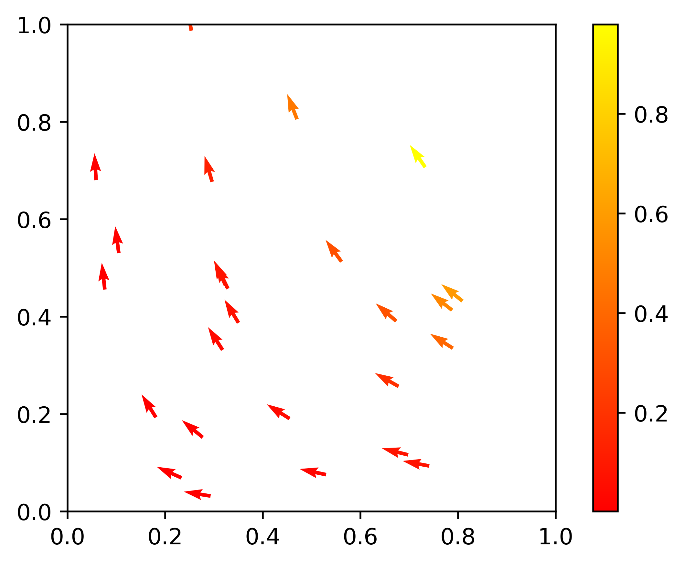
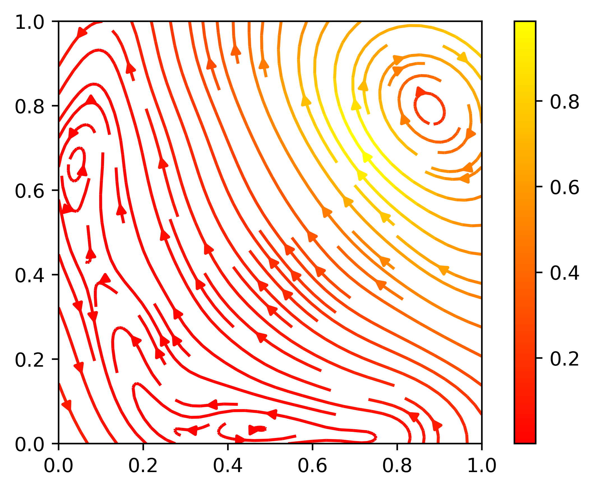
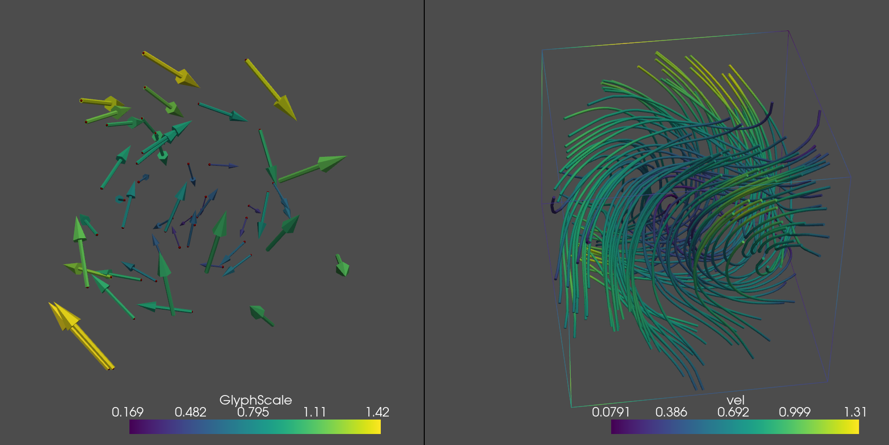

# Divergence Free Interpolation

Divergence free vector field interpolant for 2D and 3D cases. 
Described in [[1]](#1), relies on radial basis functions [[2]](#2). 
The current implementation works as expected, but does not scale well, 
an improvement would be to implement a multilevel approach [[3]](#3), 
but implementing a thinning algorithm [[4]](#4) proved to be challenging.

<p align="center">
  
  
</p>



## Installation

```bash
  uv add Divergence-Free-Interpolant
  # or
  pip install Divergence-Free-Interpolant
```

### Development

The project is managed with [uv](https://docs.astral.sh/uv/).

```bash
  uv sync                    # create .venv with the package (editable) + dev tools
  uv run pytest              # run the tests
  uv sync --group examples   # also install matplotlib and pyvista for the examples
  uv run python examples/test_case_2D.py
```
## Basic functionality

#### Import
```python
  import numpy as np
  import Divergence_Free_Interpolant as dfi
```

#### Initialize
```python
  initialized_interpolant = dfi.interpolant(nu = 5, k = 3, dim = 3)
```
`nu` - Radial basis function parameter: `int`, default value `5`, 
in most cases does not have to be changed. Must satisfy `nu >= k + 2`, otherwise the kernel
is not guaranteed to be positive definite and a `ValueError` is raised

`k` - Radial basis function parameter (smoothness): `int`, default value `3`, 
in most cases does not have to be changed. Must be at least `1`

`dim` - Dimensionality of space to interpolate: `int`, default value `3`,
currently only supports `2` and `3`, can be expanded indefinitely.

#### Condition the interpolant
```python
  positions = np.random.rand(10, 3)
  vectorfield = np.random.rand(10, 3)
  initialized_interpolant.condition(positions, vectorfield, support_radii = 0.2, method = 'linsolve')
```
`positions` - vector field coordinates: `np.ndarray`, `shape = (N, dim)`

`vectorfield` - vector field values: `np.ndarray`, `shape = (N, dim)`

`support_radii` - kernel support radius: `float`, default value `1`

`method` - method to use for solving the linear system: `str`, default value `linsolve`,
accepts `SVD, penrose, linsolve, lstsq`

#### Interpolate
```python
  x, y, z = 0.3, 0.4, 0.6
  vector = initialized_interpolant(x, y, z)
```
`x` - x coordinates at which to interpolate: `array_like`

`y` - y coordinates at which to interpolate: `array_like`

`z` - z coordinates at which to interpolate: `array_like`

`vector` - interpolated vector values at the given points: `np.ndarray`, `shape = x.shape + (dim,)`

`__call__` is vectorized

if `dim == 2` it takes only `x, y`; passing the wrong number of coordinates raises a `TypeError`

See `examples/test_case_2D.py` and `examples/test_case_3D.py` for more detailed examples.
## References

<a id="1">[1]</a> Fuselier, Edward J. 
“Sobolev-Type Approximation Rates for Divergence-Free and Curl-Free RBF Interpolants.” 
Mathematics of Computation, vol. 77, no. 263, 2008, pp. 1407–23. 
http://www.jstor.org/stable/40234564

<a id="2">[2]</a> Wendland, H. 
Piecewise polynomial, positive definite and compactly supported radial functions of minimal degree. 
Adv Comput Math 4, 389–396 (1995). 
https://doi.org/10.1007/BF02123482

<a id="3">[3]</a> Patricio Farrell, Kathryn Gillow, Holger Wendland, 
Multilevel interpolation of divergence-free vector fields, 
IMA Journal of Numerical Analysis, Volume 37, Issue 1, January 2017, Pages 332–353, 
https://doi.org/10.1093/imanum/drw006

<a id="4">[4]</a> Floater M. S. Iske A. 
Thinning algorithms for scattered data interpolation . 
BIT , 38 , 705 –720 . (1998) 
